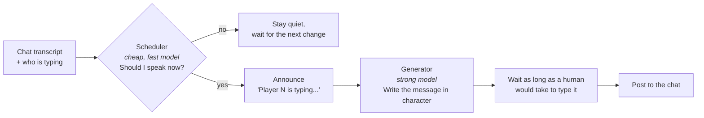
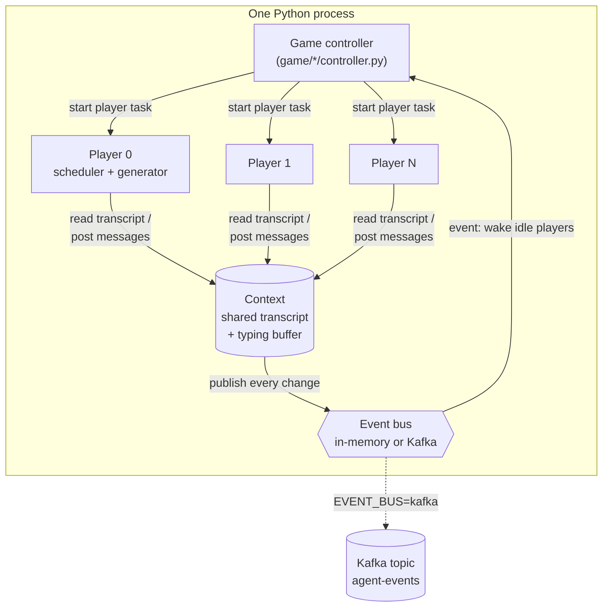
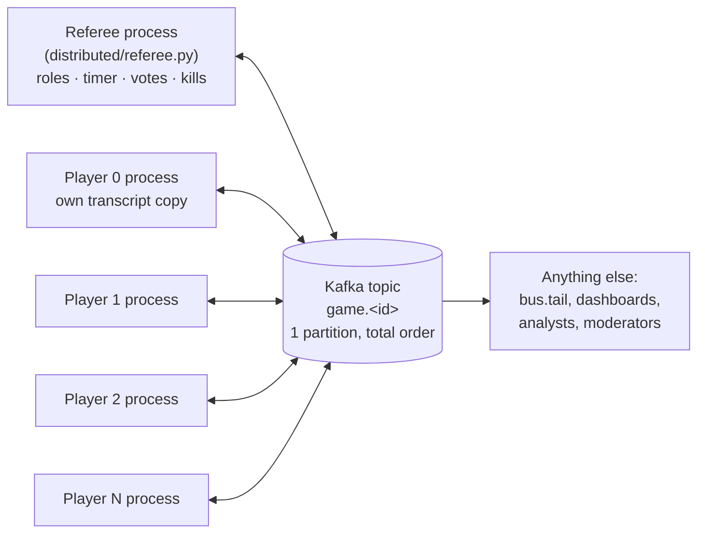
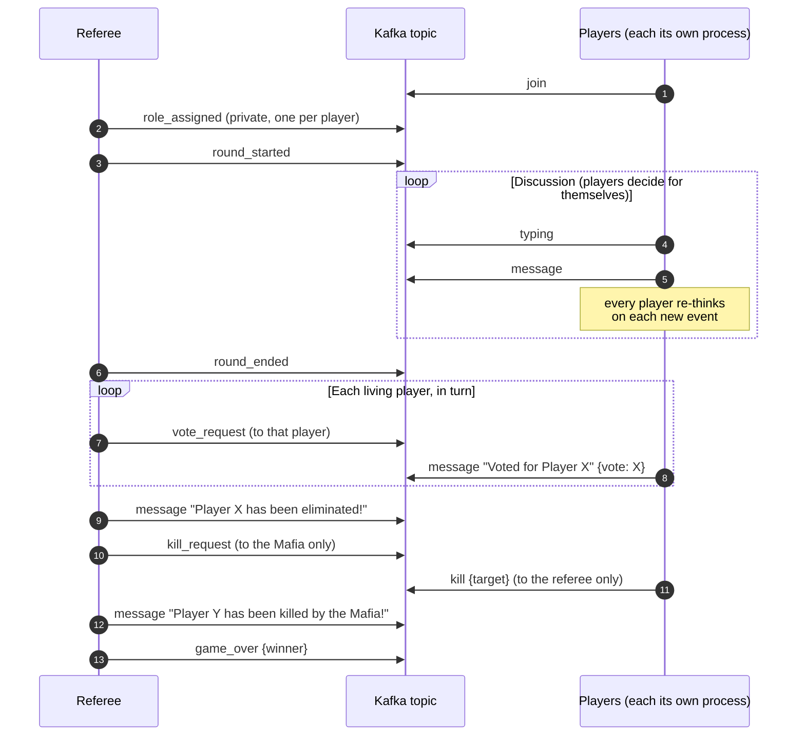

# Multi-Agent Orchestration

**LLM agents playing social deduction games in a live, concurrent group chat, orchestrated
in-process or across separate processes over Kafka.**

Most multi-agent demos have agents take turns: A speaks, then B, then C. Here there are no
turns. Every player is an autonomous agent that watches the conversation and decides *for
itself* when to jump in, so discussions unfold the way a real group chat does, with
interruptions, overlapping replies, and the pressure of seeing `Player 3 is typing...`.

Two games ship with the framework:

| Game | Rules |
|------|-------|
| **Mafia** | One hidden Mafia player. Each day everyone discusses and votes someone out; each night the Mafia secretly kills a player. Civilians win by voting out the Mafia; the Mafia wins when only one civilian is left. |
| **Undercover** | Civilians share a secret word; impostors get a blank. Everyone gives a one-word clue, then the group discusses and votes out whoever seems to be faking. |

Here's an excerpt from a real Mafia game played by five agents running as five separate
processes (Player 2 is secretly the Mafia):

```text
[21:04:42] Player 2: Alright, I'll start. Right now, I trust Player 3 the least. It feels like
           you're trying to seize control of the conversation a little too aggressively...
[21:05:22] Player 1: Three people have already called out Player 4 for being quiet and dodgy,
           and Player 4 still hasn't given a real answer...
[21:05:52] Game: Player 4 has been eliminated!
[21:05:53] Game: Player 1 has been killed by the Mafia!
[21:08:10] Player 3: Player 2, you went pretty hard on me with the "classic Mafia" accusation,
           then swung your vote instantly to Player 4 when the tide turned...
[21:08:13] Game: Player 2 has been eliminated!
🎉 Mafia 2 has been eliminated! Civilians win!
```

---

## Contents

- [Quick start](#quick-start)
- [Architecture](#architecture)
  - [The player: two agents, one voice](#the-player-two-agents-one-voice)
  - [Simulated typing](#simulated-typing)
  - [Two ways to orchestrate](#two-ways-to-orchestrate)
  - [In-process mode](#in-process-mode)
  - [Distributed mode](#distributed-mode)
  - [Event reference](#event-reference)
- [Running games](#running-games)
- [Configuration](#configuration)
- [Watching and replaying games](#watching-and-replaying-games)
- [Project layout](#project-layout)
- [Limitations and next steps](#limitations-and-next-steps)

---

## Quick start

Requires Python 3.10+ and an OpenAI API key.

```bash
pip install -r requirements.txt
```

```bash
echo "OPENAI_API_KEY=your-key-here" > .env
```

**Simplest run** (one Python process, no Kafka):

```bash
python main.py
```

**Distributed run** (a referee + one process per player, linked only by Kafka; needs
Docker for the broker):

```bash
docker compose up -d
```

```bash
python -m distributed.launch --players 5
```

**No local setup at all:** add `OPENAI_API_KEY` as a repository secret and run the
**Run game** workflow from the Actions tab. See [GitHub Actions](#on-github-actions).

---

## Architecture

### The player: two agents, one voice

Each player is a pair of LLM agents with different jobs, and usually different models:



- **Scheduler** (`agent/scheduler.py`) runs every time the conversation changes and
  answers a single yes/no question, as a structured `ShouldSpeak` output. It fires
  constantly, so it should be cheap. This is what replaces turn-taking: a player speaks
  when *it* judges the moment is right.
- **Generator** (`agent/generator.py`) runs only when the scheduler says yes. It knows the
  player's hidden role (and secret word, in Undercover) and writes the actual message.
- **Structured decisions** (votes, night kills, clue words) reuse the generator, cloned
  with a Pydantic `output_type` (`SelectPlayer`, `SayWord`), so the model must return a
  parseable answer instead of prose.

Agents are built with the [OpenAI Agents SDK](https://github.com/openai/openai-agents-python).

### Simulated typing

Once a player decides to speak, everyone else immediately sees `Player N is typing...` and
can react to it, for example by hurrying to get their own point in first. The message
itself is held back for `40 × words / 60` seconds, roughly human typing speed. Short
replies land first; long speeches arrive late and may already be outdated when they do.

### Two ways to orchestrate

The same players and prompts can be wired together in two ways:

| | **In-process mode** | **Distributed mode** |
|---|---|---|
| Entry point | `python main.py` | `python -m distributed.launch` |
| Processes | 1 | 1 referee + 1 per player |
| Shared state | In-memory `Context` singleton | None. Each player rebuilds its own view from Kafka |
| Who runs the rules | Game controller (`game/*/controller.py`) | Referee process (`distributed/referee.py`) |
| How agents are woken | Event bus subscription (in-memory **or** Kafka) | Each player consumes the game's Kafka topic |
| Kafka | Optional (`EVENT_BUS=kafka`) | Required |
| Crash recovery | No | Players can be restarted mid-game |
| Games | Mafia, Undercover | Mafia |

Both modes follow the same idea: **the orchestrator runs the rules, the agents run the
conversation.** The orchestrator opens and closes rounds, collects votes and announces
results. Inside a discussion round nobody is in charge; each agent decides on its own when
to talk.

### In-process mode



- **`Context`** (`context/Context.py`) is an asyncio-guarded singleton holding the full
  transcript and the typing buffer. Every player reads it, so everyone sees the same
  chat.
- Every change to the context (a message, a typing indicator, a round announcement) is
  **published to the event bus** (`bus/`).
- The **controller** subscribes to the bus. When an event arrives, it wakes every idle
  player as its own `asyncio` task to re-run its scheduler. A burst of events causes a
  single wake-up.
- The round ends on a wall-clock timer; the controller waits for in-flight messages, then
  runs the vote (and, in Mafia, the night kill).

The bus has two interchangeable backends, selected by `EVENT_BUS`:

- **`memory`** (default) fans events out inside the process. There are no extra
  dependencies.
- **`kafka`** writes every event to a Kafka topic (keyed by game id, so one game stays
  ordered) and wakes the controller from what it reads back. The game plays the same,
  but now every event is durable and visible to outside tools.

### Distributed mode

Here Kafka is not a side channel: it is the *only* thing connecting the agents. Every
player is a separate OS process with no shared memory, and each could run on its own
machine.



**One topic per game.** Each game gets its own topic, `game.<id>`, with a single partition,
so every process sees every event in exactly the same order.

**Players build their own world.** A player process reads the topic from the very beginning
and builds its own copy of the transcript and "is typing…" state from events. It never
reads anyone else's memory.

**The referee is a light orchestrator.** It never calls a player. It publishes phase
changes and requests, then waits for the matching replies to appear on the topic:



**Each player thinks continuously, but never twice at once.** When a new event arrives
while a player is still thinking or typing, it marks itself as having new input and thinks
again as soon as it's done. It always reacts to the latest state, and never has two
thoughts racing each other.

**Crash recovery by replay.** Because the topic is the full history of the game, a player
that crashes can simply be started again with the same `--game` and `--id`. It replays the
topic, recovers its role, the transcript and whether it's still alive, and carries on.
Events from before the restart only rebuild state; they never trigger actions, so it
won't vote twice or answer old requests. (This is tested by killing a player mid-round and
restarting it.)

**Private information.** Role assignments and the Mafia's kill request and reply carry a
`to` field. Players ignore events addressed to others and keep them out of their
transcript, so an agent's prompt only ever contains what that player is allowed to know.
This keeps honest agents honest; it is not access control, since anyone who can read the
topic can see these events.

**Why this matters.** Once agents only meet on a log, new participants need no changes to
existing code. A live dashboard, a moderator agent, a post-game analyst, or a player
backed by a different model or provider is just another process reading and writing the
same topic.

### Event reference

Every event is a JSON record (`bus/events.py`):

```json
{
  "game_id": "ce5ba3ac-688b-4311-a9e6-bd6f76bded7f",
  "kind": "message",
  "sender": "Player 3",
  "text": "Voted for Player 2",
  "ts": 1795036093.2,
  "to": null,
  "data": {"vote": 2}
}
```

| `kind` | From → to | Meaning | `data` |
|--------|-----------|---------|--------|
| `join` | player → all | Process is up and listening (distributed only) | |
| `role_assigned` | referee → one player | Your hidden role | `{"role": "Mafia" \| "Civilian"}` |
| `round_started` | controller/referee → all | Discussion is open; `text` holds the announcement | |
| `typing` | player → all | "I'm writing a message" | |
| `message` | anyone → all | A chat line. Votes and announcements are messages too | votes: `{"vote": 3}`, eliminations: `{"eliminated": "Player 3"}` |
| `round_ended` | referee → all | Discussion closed; finish what you're typing | |
| `vote_request` | referee → one player | Your turn to vote | |
| `kill_request` | referee → Mafia | Choose tonight's victim | |
| `kill` | Mafia → referee | The chosen victim | `{"target": 3}` |
| `game_over` | referee → all | Game finished; processes exit | `{"winner": "Mafia" \| "Civilians"}` |

In-process mode uses `message`, `typing` and `round_started`; distributed mode uses them
all (see `distributed/protocol.py`).

---

## Running games

### Locally, one process

```bash
python main.py                    # Mafia, 5 players
```

```bash
GAME=undercover python main.py    # Undercover, 5 players, 1 impostor
```

The same game with every event also going through Kafka:

```bash
docker compose up -d
```

```bash
EVENT_BUS=kafka python main.py
```

### Locally, distributed

```bash
docker compose up -d
```

```bash
python -m distributed.launch --players 5
```

`launch` is only a convenience: it creates the game's topic and starts the referee and one
player process per seat. To spread a game across terminals or machines, start the pieces
yourself with the same game id and broker:

```bash
python -m distributed.referee --game my-game --players 5
```

```bash
python -m distributed.player --game my-game --id 0
```

Repeat the player command for `--id 1` through `--id 4`. Players can use different models
from each other (`--generator-model`, `--scheduler-model`).

### On GitHub Actions

`.github/workflows/run-game.yml` runs one game on a GitHub runner, with a Kafka broker as
a service container. You don't need anything installed locally.

1. Add your key as a repository secret named `OPENAI_API_KEY`
   (**Settings → Secrets and variables → Actions**).
2. Go to **Actions → Run game → Run workflow** and pick the game (`mafia` /
   `undercover`) and the mode (`in-process` / `distributed`).
3. When it finishes, the game transcript and a full dump of the Kafka events are attached
   to the run as a downloadable artifact.

Each run is one full game and uses your OpenAI credits. Games only start when you run the
workflow by hand.

---

## Configuration

### Environment variables

| Variable | Default | Used by | Purpose |
|----------|---------|---------|---------|
| `OPENAI_API_KEY` | (required) | all | OpenAI API key (read from `.env` too) |
| `GAME` | `mafia` | `main.py` | `mafia` or `undercover` |
| `EVENT_BUS` | `memory` | in-process mode | `memory` or `kafka` |
| `KAFKA_BOOTSTRAP_SERVERS` | `localhost:9092` | Kafka bus, distributed mode, `bus.tail` | Broker address |
| `KAFKA_TOPIC` | `agent-events` | in-process Kafka bus, `bus.tail` | Topic for in-process games |

### Models and prompts

In-process games take their models and prompts from the `config` dict at the top of each
controller:

```python
config = {
    "generator_model_name": "gpt-4.1",       # writes messages
    "scheduler_model_name": "gpt-4.1-mini",  # decides when to speak
    ...
}
```

Distributed players take `--generator-model` / `--scheduler-model` flags (same defaults),
on `distributed.launch` or on each `distributed.player`.

Mixing model tiers is deliberate: the scheduler fires on every change and should be cheap;
the generator runs only when a player actually speaks and should be good.
`game/undercover/controller.py` also has commented-out LiteLLM model strings for running
against non-OpenAI providers.

Prompts live in `game/<game>/prompts.py`. The scheduler prompt is the main lever for how
chatty games are.

### Game settings

| Setting | Where |
|---------|-------|
| Number of players | `n_players` on `Game(...)` in `main.py`; `--players` in distributed mode |
| Number of impostors (Undercover) | `n_imposters` on `Game(...)` in `main.py` |
| Discussion length | Mafia: `duration_minutes` on `run_round` (default 1.5); Undercover: `round_duration` on `Game`; distributed: `--round-minutes` |
| Secret words (Undercover) | `game/undercover/words.txt` |

---

## Watching and replaying games

Everything is printed live to the console and written to
`logs/<game>_log_<timestamp>.log`. Hidden information (who the Mafia is, the secret word)
is printed for you; the agents never see it.

With Kafka, any game can be followed or replayed from another terminal:

```bash
python -m bus.tail                                          # live, in-process games
```

```bash
python -m bus.tail --from-beginning --game <game_id>        # replay one in-process game
```

```bash
python -m bus.tail --topic game.<id> --from-beginning       # replay a distributed game
```

Private events show their recipient, e.g. `role_assigned  Game -> Player 2`.

---

## Project layout

```text
main.py                     entry point for in-process games (GAME=mafia|undercover)
logger_config.py            per-game console + file logging
requirements.txt
docker-compose.yml          single-node Kafka (KRaft) for local runs

agent/                      the agents every player is made of
  Player.py                 in-process player: scheduler → typing → generator → post
  scheduler.py              "should I speak?" agent (ShouldSpeak)
  generator.py              message-writing agent

context/
  Context.py                in-process shared transcript + typing buffer;
                            publishes every change to the event bus

bus/                        event bus for in-process mode
  events.py                 Event record (shared by both modes)
  base.py                   EventBus interface + per-game Subscription
  memory.py                 in-memory backend (default)
  kafka.py                  Kafka backend; topic creation helper
  tail.py                   CLI: follow or replay events from Kafka

game/                       in-process game rules and prompts
  mafia/
    controller.py           discussion → vote → night kill
    player.py               MafiaPlayer: vote(), kill()
    prompts.py
  undercover/
    controller.py           clue words → discussion → vote
    player.py               UndercoverPlayer: vote(), contribute_word()
    prompts.py
    words.txt               secret word pool

distributed/                Mafia with one process per player, linked only by Kafka
  launch.py                 starts a referee + N players locally
  referee.py                game rules: roles, rounds, votes, night kill
  player.py                 one autonomous player process
  channel.py                a process's connection to its game's topic
  protocol.py               event kinds

.github/workflows/
  run-game.yml              run one game on GitHub Actions

logs/                       transcripts from earlier runs
```

---

## Limitations and next steps

- **Distributed mode supports Mafia only.** Undercover still runs in-process; porting it
  means adding a clue-word phase to the referee.
- **The referee can't recover from a crash.** Players can be restarted mid-game; the
  referee can't yet.
- **Private events aren't secret.** They're filtered by the players, not protected by
  Kafka. Real secrecy would need per-player topics with ACLs.
- **One Mafia player.** The Mafia controller and referee assume a single Mafia member.
- **Ideas:** players backed by different model providers in the same game, a live web
  dashboard reading the topic, a moderator or commentator agent, and post-game analysis
  of who suspected whom and when.
